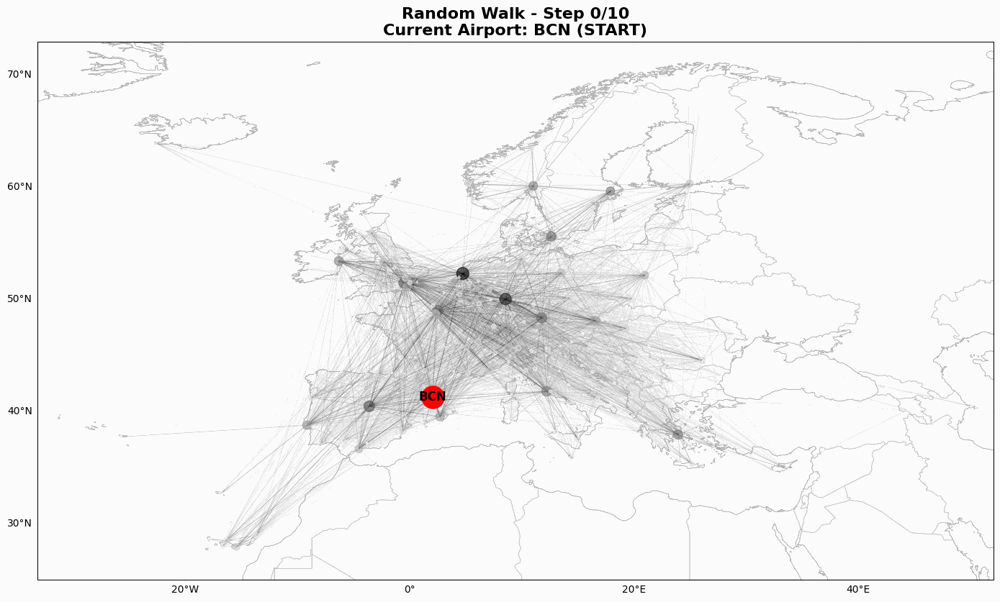
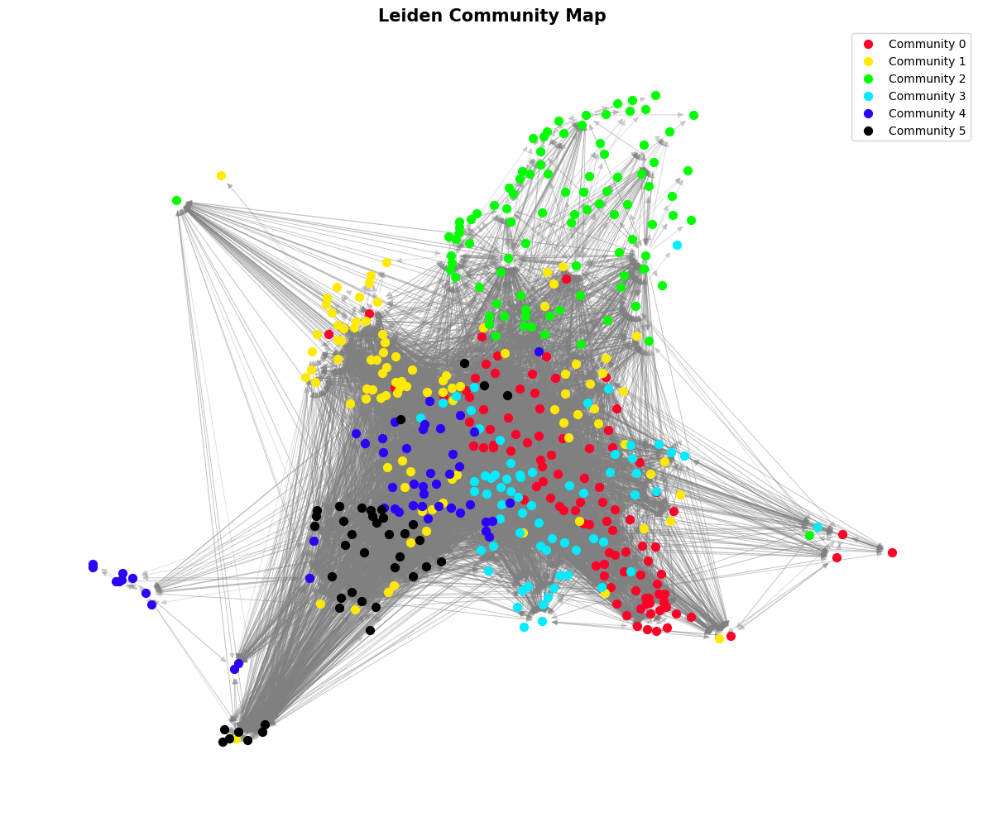

# Network Analysis of the European Air Transportation System

Complex network analysis of the European air transportation system as a directed weighted graph: structure, communities, sparsification, robustness, diffusion and optimal routing.

Group project for the Complex Networks course of the MSc in Health Data Science (MHEDAS), Universitat Rovira i Virgili.

## Overview

This project models the European air transportation system as a directed network of 445 airports and 12641 routes, weighted by weekly flight frequency. Airports are nodes, routes are directed edges, and ticket price and flight duration are kept as extra attributes of each route.

Using tools from complex network theory, it studies the macroscopic and microscopic structure of the network, its community structure, how it can be simplified with sparsification, how robust it is to random failures and targeted attacks, how traffic spreads through it as a random walk, and how to find the best route between two airports.

## Results

The network is compact, strongly reciprocal and organised around a few hubs.

| Measure | Value |
|---------|-------|
| Airports | 445 |
| Routes | 12641 |
| Largest strongly connected component | 239 airports (53.7%) |
| Average path length (largest strongly connected component) | 1.86 |
| Diameter (largest strongly connected component) | 4 |
| Reciprocity | 0.8867 |
| Percolation threshold, random failure | about 0.80 |
| Nodes removed to break the network, targeted attack | about 30-34% |

Key findings:

- **Hub-and-spoke structure.** The median degree is 72 against an average of 526. Both the unweighted and weighted degree distributions are heavy-tailed (log-log fit exponents of about 1.08 and 1.02).
- **Distinct airport roles.** Amsterdam Schiphol (AMS) leads in eigenvector centrality and PageRank. London Stansted (STN) has the most direct routes (319). Munich (MUC) and Vienna (VIE) are the most accessible by flight duration. Stockholm (ARN) and Oslo (OSL) act as the main bridges (highest betweenness).
- **Communities.** Louvain and Leiden find 5-6 regional communities that follow European geography. Infomap and the Stochastic Block Model find a single dominant core with smaller peripheral groups.
- **Robust but fragile.** Under random failure the network holds until about 80% of nodes are removed, but targeted attacks on high-strength or high-betweenness airports break it after removing only about 30-34% of nodes.
- **Diffusion.** Weighted random walks from Barcelona (BCN) reach 90.3% of airports within 50 steps and are biased toward major hubs. Removing Munich (MUC) causes the largest drop in coverage (about 3%).
- **Routing.** A route finder computes the cheapest, fastest, fewest-transfer and best-overall routes between any two airports.





## Data

The analysis uses the [European Airports & Air Routes](https://www.kaggle.com/datasets/lunthu/european-airlines-routes) dataset from Kaggle. Each row is a direct flight connection with geographic, temporal and economic attributes.

| File | Description |
|------|-------------|
| `data/europe_air_routes.csv` | Raw dataset |
| `data/cleaned_df.csv` | Filtered and cleaned dataset used to build the network |

Pre-processing: only routes with both airports in Europe were kept, airports are identified by IATA code, missing coordinates were completed manually, and routes with zero weekly flights were removed.

## Methods

1. **Network construction:** nodes are airports and directed edges are routes, with weekly flights as the edge weight and ticket price and duration as extra attributes.
2. **Structural characterisation:** strengths, density, clustering, reciprocity, assortativity, average path length and diameter (on the largest strongly connected component), and degree distributions.
3. **Centrality:** degree, weighted in- and out-degree, betweenness, closeness (weighted by duration), eigenvector centrality and PageRank.
4. **Community detection:** Louvain, Leiden, Infomap and the Stochastic Block Model.
5. **Sparsification:** weight thresholding and the disparity filter.
6. **Robustness:** percolation under random failure and under targeted attacks on degree and betweenness.
7. **Diffusion:** simple and weighted random walks, time-dependent occupation probability, first passage time, and the impact of node and edge failures.
8. **Routing:** cheapest, fastest, fewest-transfer and best-overall paths, where the best overall route combines price, duration and transfers.

The full methodology, results and discussion are in [`docs/air_transport_network_report.pdf`](docs/air_transport_network_report.pdf),.

## Repository structure

```
.
├── data/
│   ├── cleaned_df.csv
│   └── europe_air_routes.csv
├── docs/
│   ├── air_transport_network_presentation.pdf
│   └── air_transport_network_report.pdf
├── figures/             
├── notebooks/
│   └── air_transport_network_analysis.ipynb
├── README.md
└── requirements.txt
```

## How to run

```bash
git clone https://github.com/cindychenqiu/european-air-transport-network.git
cd european-air-transport-network
python -m venv .venv
source .venv\Scripts\activate # on macOS/Linux .venv/bin/activate 
pip install -r requirements.txt
jupyter notebook notebooks/air_transport_network_analysis.ipynb
```

Run the notebook from top to bottom. To find the best routes between two airports, call `print_routes(G, "BCN", "AMS")` after building the graph.

Tested with Python 3.12.

## Limitations and next steps

- **Static network:** flight frequencies, prices and routes are treated as fixed. Temporal or multilayer networks would be more realistic.
- **Average prices:** the price is the average across the airlines on a route, which hides low-cost carrier effects, seasonality and fare classes.
- **No airline or demand detail:** the network ignores differences between airlines, time of day and passenger demand. Airline-specific layers or passenger flow data could address this.
- **Topological robustness only:** robustness is measured with network measures (size of the largest strongly connected component, path length and efficiency). Capacity constraints and cascading delays are not captured.

## Authors and acknowledgements

Group project by Keith Megara Osores Vicuña, Maria del Pilar Fernandez Barrera and Cindy Chen.  
  
[LinkedIn](https://www.linkedin.com/in/cindychenqiu/) | [GitHub](https://github.com/cindychenqiu)